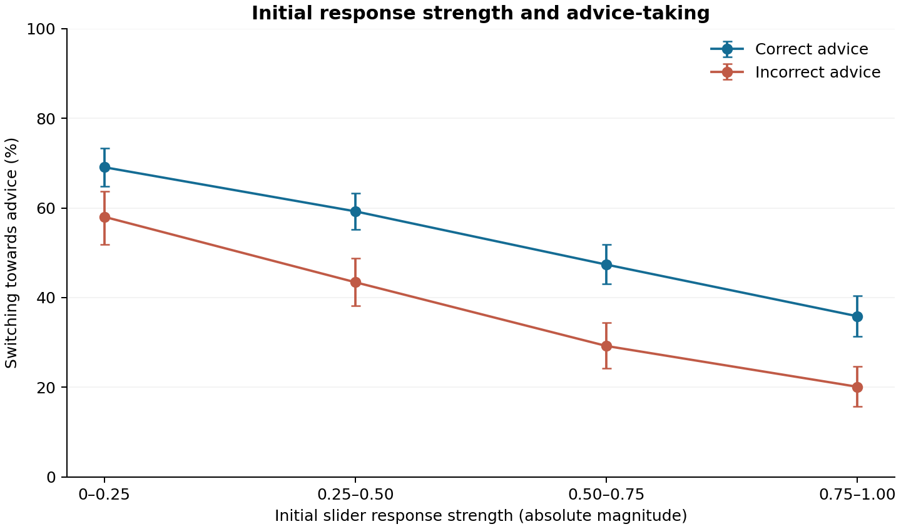

# When advice helps and when it misleads
## Exploratory secondary analysis of real human advice-taking data

### Main finding
Across 567 participants in the AI-labelled condition, participant-averaged accuracy increased from 68.8% to 76.2%. The mean within-participant change was 7.4 percentage points (95% participant-bootstrap interval 6.6–8.2). Improved average accuracy coexisted with harmful changes to some initially correct decisions. These are descriptive sample results, not causal estimates.

### Research questions
1. How does decision accuracy change after AI-labelled advice across tasks?
2. When people initially disagree with advice, how often do they switch towards correct versus incorrect advice?
3. How is initial response strength associated with switching?

### Source and study context
Original data: Vodrahalli, Daneshjou, Gerstenberg and Zou, *Do Humans Trust Advice More if it Comes from AI? An Analysis of Human-AI Interactions*, AIES 2022, pp. 763–777. DOI: https://doi.org/10.1145/3514094.3534150. Data: https://github.com/kailas-v/human-ai-interactions (pinned commit 24881cc7586180a9c9742a7dd838aea97d008235).

The original researchers recorded decisions before and after advice in binary classification tasks. Advice source was presented as human or AI; in the main experimental setup, advice content was controlled and derived from earlier human judgements, with perturbations. The project studies responses to advice labels, not use of a live generative model. The release pools several experiments, including a specialist dermatology task. Task instances were repeated within participants; this is not a longitudinal career study.

### Data and exclusions
The source CSV contains 35,670 trials from 1,125 participant identifiers across five tasks. Required analysis fields had no missing values and no duplicate participant–task–order keys. Exactly 959 trials had a midpoint (zero) initial or final response, so categorical analyses exclude those trials: 34,711 remain. The AI-labelled primary sample has 17,521 retained trials from 567 participants. The human-labelled arm is reported separately in the CSV for transparency; pooled arm differences are not interpreted as causal effects.

### Measurement
Positive signed responses denote correct labels in the source encoding; negative responses denote incorrect labels. Correctness is therefore determined from sign, not by matching label text. Beneficial switching is choosing the correct advice label after an initially incorrect decision; harmful switching is choosing the incorrect advice label after an initially correct decision. Both rates condition on initial disagreement and non-midpoint responses.

Within each eligible subset, the rate is first calculated per participant and then averaged equally over participants. Participants without eligible trials for that metric are omitted from that metric only. This gives a participant-averaged estimand, not a pooled-trial proportion. Each reported row includes its eligible trial count and participant count. Initial response strength is the absolute slider magnitude; it is not a probability of correctness. No Brier score, confidence gap or validated calibration measure is claimed.

### Results
| AI-labelled condition | Estimate and interval | Eligible trials | Participants |
|---|---|---:|---:|
| Before-advice accuracy | 68.8% (95% interval 67.9–69.7%) | 17,521 | 567 |
| After-advice accuracy | 76.2% (95% interval 75.3–77.0%) | 17,521 | 567 |
| Beneficial switching on disagreement | 52.5% (95% interval 49.7–55.4%) | 3,542 | 557 |
| Harmful switching on disagreement | 38.7% (95% interval 35.3–42.1%) | 1,813 | 494 |

The beneficial and harmful switch rates have different eligible participants and denominators. They should not be subtracted as a paired effect or treated as a formal discrimination score.

| Task | Participants | Retained trials | Before | After | Change |
|---|---:|---:|---:|---:|---:|
| Art | 278 | 8691 | 66.5% | 76.0% | +9.5 pp |
| Census | 43 | 1352 | 71.3% | 74.9% | +3.5 pp |
| Cities | 79 | 2448 | 72.4% | 78.9% | +6.5 pp |
| Dermatology | 20 | 462 | 70.5% | 76.5% | +6.0 pp |
| Sarcasm | 147 | 4568 | 70.3% | 75.5% | +5.2 pp |

Task differences and response-strength patterns are exploratory. Differences in item difficulty, advice accuracy, experimental settings and participant composition may explain them. The analysis does not isolate these influences.

### Uncertainty and sensitivity checks
Intervals use 2,000 percentile bootstrap samples of participants, with seed 20261105. This preserves within-participant dependence and treats observed items as fixed. It does not account for generalising to a new item population or provide simultaneous intervals across all comparisons. There are no confirmatory hypothesis tests. In dermatology, harmful switching was zero across 46 eligible trials from 20 participants; its bootstrap interval collapses to zero because resampling cannot generate an unobserved event. This does not establish zero population risk.

Scoring midpoint responses as 0.5 correct, rather than excluding them, gives an AI-arm accuracy change of +7.6 percentage points (95% interval 6.8–8.4). Excluding dermatology gives +7.4 percentage points (6.6–8.2). Both preserve the descriptive direction of change. Half-credit is a sensitivity convention, not proof that midpoint responses are correct half the time. See sensitivity.csv for exact values.

### Interpretation and relevance to DC13
This exercise shows why overall task success alone is insufficient for understanding advice-taking: aggregate improvement can coexist with switching away from an initially correct judgement. It motivates future work on how professionals learn to question suggestions and retain responsibility. It does not demonstrate professional agency, workplace learning, early-career differences or generative-AI literacy. Those require additional measures and a new study.

### Limitations
- Existing, pooled experiments; analyses are exploratory and not preregistered.
- Source labels are perceived sources, not proof of the actual origin of advice.
- Binary task switching measures behaviour, not motivation, verification work or trust itself.
- No repeated career-stage observations and no justified early-career subgroup.
- No probability-calibration analysis: slider strength is not assumed to be a calibrated probability.
- Selective midpoint exclusion is addressed only through the stated sensitivity analysis.
- Intervals reflect participant sampling conditional on these items; no causal or population-wide claim.
- This is a focused secondary-analysis exercise, not a full replication of the original paper.

### Contribution 
The original authors designed the experiments and collected the data. This portfolio draft's analysis code, documentation and interpretation were prepared by Zesmin Nahar. The pipeline has been run and checked in this session. 
